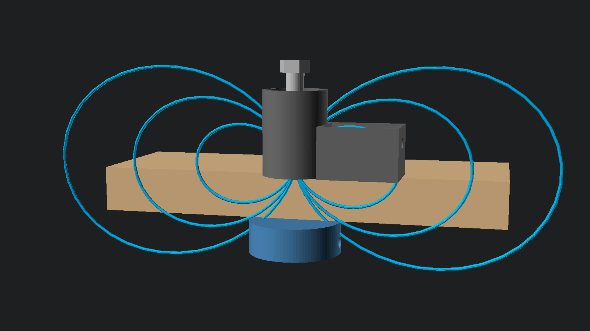
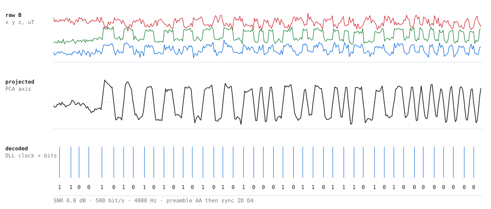
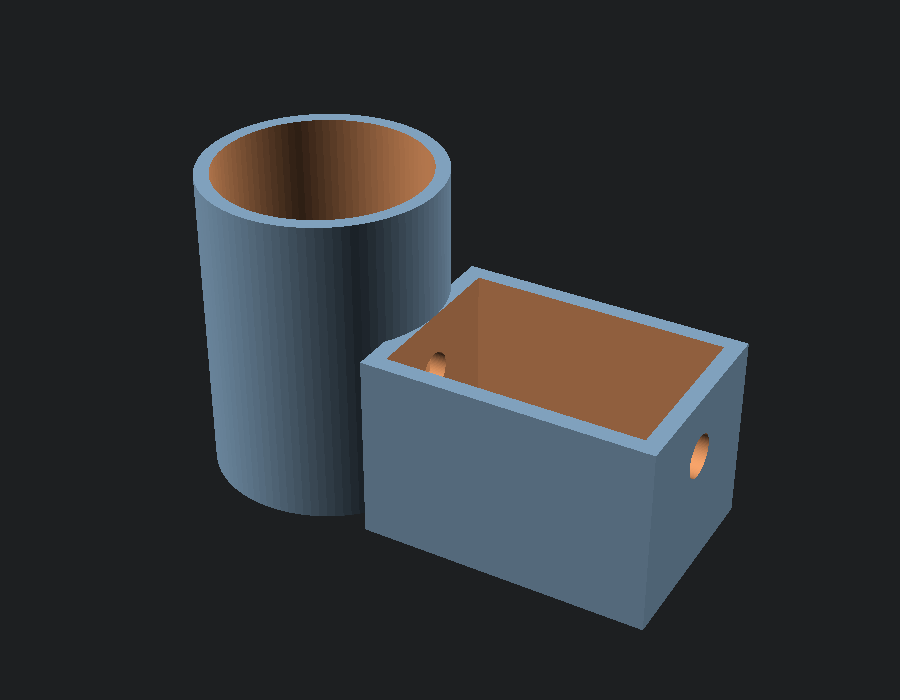
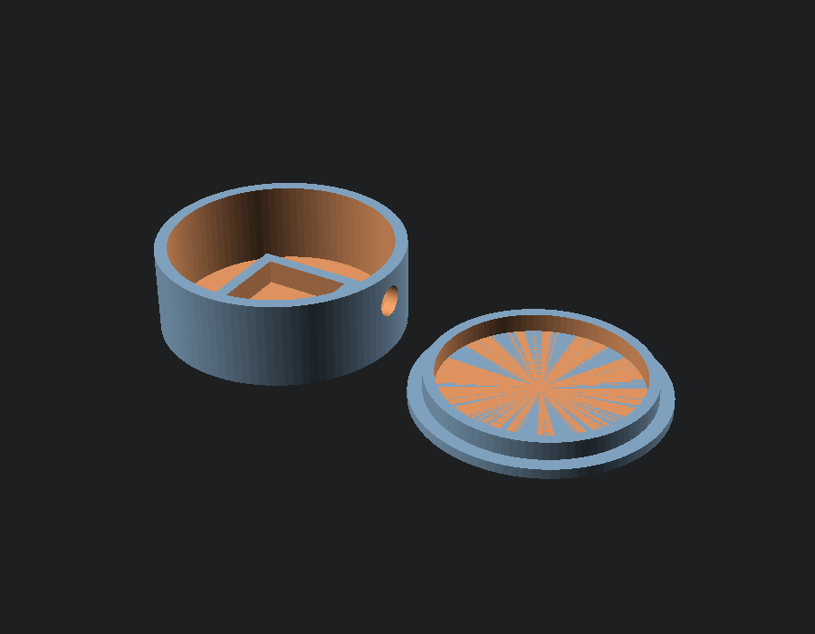
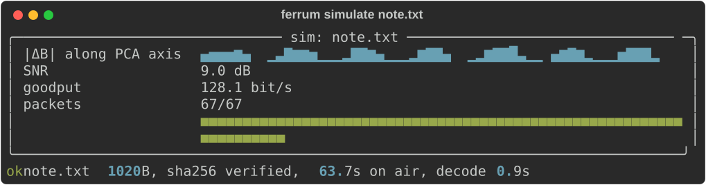
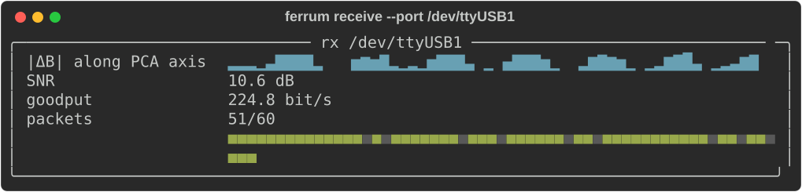

# FerrumFS

[](https://github.com/MarcoZorn/FerrumFS/actions/workflows/ci.yml)

**A filesystem whose storage medium is a magnetic field in free space.**



A coil on one side of a table pulses a file into the air as Manchester-coded
magnetic flux. A magnetometer on the other side, through 2 cm of solid wood,
catches it, repairs it with Reed-Solomon and checks its SHA-256. Mount it with
FUSE and `cp foto.png /mnt/ferrum/` sends the file through the desk.

The transmitter replays the file forever, so the space around the coil works
like a platterless spinning disk (or a delay-line memory). A receiver can show
up at any time, collect whichever frames it is still missing, and rebuild the
file.

```
 file ──► chunk + RS + CRC ──► ESP32 ──► MOSFET ──► coil  ~~~ B field ~~~►  magnetometer ──► ESP32 ──► host ──► file
          (host_cli)            TX: hw-timer Manchester        |ΔB| through wood/glass      RX: CSV samples    PCA + DLL demod
```

## How it works



*One simulated frame. Top: raw field on the X, Y and Z axes, riding on the
earth's field, drift and hum. Middle: the detrended signal projected onto its
principal axis. Bottom: the clock the decoder locks onto each bit (blue ticks)
and the decoded bits. The preamble `AA` = `10101010` is followed by the sync
word `2D D4`. Generated from the real code by `docs/make_figures.py`.*

| Layer | Where | What |
|---|---|---|
| Application | `host_cli` | file → blob `size · name · sha256 · data`, cut into 16 B chunks (max 4 KiB per file) |
| Link + FEC | `host_cli/ferrumfs/encoder.py` | frame `AA AA · 2D D4 · SEQ · LEN · 16 B payload · RS 4 B · CRC16` (28 B). RS(22,18) repairs 2 bad bytes; CRC is checked *after* repair |
| PHY TX | `firmware_tx` | Manchester (`0` = high→low, `1` = low→high), hardware timer at the half-bit rate, frames looped with 8-bit coil-off gaps |
| PHY RX | `firmware_rx` | fixed-rate sampling, CSV over USB serial: Hall on ADC (4 kHz) or QMC5883L over I²C (200 Hz) |
| Demod | `host_cli/ferrumfs/decoder.py` | detrend → PCA axis → per-bit delay-locked clock → matched filter → sync search → RS → CRC → assemble → SHA-256 |

**Ignoring the Earth's field.** The earth's field (~25–65 µT), drift and 50 Hz
hum are removed with a 4-bit moving-average detrend, which works because every
Manchester bit is DC-free. The detrended 3-axis signal is then projected onto
its principal axis (PCA), so the receiver can be rotated any way. With a 1-axis
Hall sensor the projection does nothing.

**Clock recovery.** Every Manchester bit has an edge in the middle. The decoder
locks onto each mid-bit edge and looks for the next one one bit period later,
within ±T/4. This corrects TX/RX clock mismatch and jitter on every bit. A
matched filter, the late half-bit minus the early half-bit, decides each value.
After two missed edges (an idle gap), the decoder drops lock and re-acquires
it on the next preamble.

**Decoding on the host.** The RX board only streams raw samples, and the host
decodes them with the same code the simulator tests.

## Hardware

| Part | Notes |
|---|---|
| 2× ESP32 (WROOM-32 or C3) | change `board =` in `platformio.ini` for C3 |
| Coil | 100–200 turns of 24–28 AWG enamelled wire on an M8 iron bolt or ferrite rod; a salvaged 5 V/12 V relay coil also works |
| N-MOSFET, logic-level | IRLZ44N / AO3400 |
| Flyback diode | 1N4007 or Schottky, **reverse-biased across the coil**. Without it the inductive kick kills the ESP32 |
| (optional) DRV8833 | bipolar N/S drive: set `PIN_COIL_B` in `firmware_tx/src/main.cpp` |
| Sensor | SS49E / DRV5053 analog Hall (fast, ~500 bps) **or** QMC5883L / GY-271 (3-axis, orientation-invariant, ~25 bps) |

### Wiring

```
TX                                    RX (Hall)               RX (QMC5883L)
GPIO25 ──[100Ω]── MOSFET gate         SS49E OUT ── GPIO34     SDA ── GPIO21
          10k gate→GND                VCC 3V3, GND            SCL ── GPIO22
coil: +V ──┬── coil ──┬── drain                                VCC 3V3, GND
           └──◄|──────┘  (diode, cathode to +V)
source ── GND (common with ESP32)
```

### Enclosures

| TX coil pod | RX sensor pod |
|---|---|
|  |  |

`hardware/*.scad` are parametric OpenSCAD files (STLs are attached to each
[release](https://github.com/MarcoZorn/FerrumFS/releases) and built by CI). The TX pod holds the coil
vertically with the core flush against a 0.8 mm floor. The RX pod centres the
sensor on the coil axis. Put one pod on top of the table and one directly
underneath it. `hardware/assembly.scad` is the scene in the image at the top.

## Usage

```bash
cd host_cli
uv venv && uv pip install -e '.[fuse]'      # or: pip install -e .

# 1. no hardware: push a file through the noisy channel model
ferrum simulate some_file.txt
ferrum simulate some_file.txt --fs 200 --bitrate 25 --amp 4 --noise 0.6   # QMC5883L profile
python test_roundtrip.py

# 2. flash
cd ../firmware_tx && pio run -t upload
cd ../firmware_rx && pio run -e rx_hall -t upload     # or -e rx_qmc

# 3. transmit / receive
ferrum send note.txt --port /dev/ttyUSB0 --bitrate 500
ferrum scope --port /dev/ttyUSB1                       # tune distance/alignment by eye
ferrum receive --port /dev/ttyUSB1                     # writes ./received/note.txt

# 4. the actual filesystem
mkdir -p /tmp/ferrum && ferrum mount /tmp/ferrum --port /dev/ttyUSB0
cp note.txt /tmp/ferrum/                               # → goes out through the coil
```





**Replay.** `--port` also accepts a CSV file. You can record a session (or
`ferrum simulate --dump cap.csv`) and run `ferrum receive --port cap.csv` to
debug the decoder offline, through the exact path used for live hardware.

QMC5883L profile: `--fs 200 --bitrate 25`. Hall profile: the defaults
(`--fs 4000 --bitrate 500`).

## Simulator

`ferrumfs/channel.py` models random sensor orientation, the earth's field with
random-walk drift, 50 Hz mains hum, gaussian noise, ±2 % TX clock error and 5 %
per-symbol jitter. With the defaults (8 µT signal, 1 µT/axis noise) about 37
of 40 frames decode on the first pass, and the loop buffer collects the rest
on later passes.

## Repo map

```
host_cli/ferrumfs/
  encoder.py     framing, RS, CRC, Manchester
  decoder.py     PCA projection, DLL clock recovery, assembler
  channel.py     noisy channel simulator
  cli.py         ferrum simulate | send | receive | scope | mount
  visualizer.py  terminal scope
  fuse_mount.py  FUSE filesystem
host_cli/test_roundtrip.py   FEC, channel, CLI replay tests
firmware_tx/ firmware_rx/    PlatformIO (ESP32, Arduino)
hardware/                    OpenSCAD pods + assembly scene
docs/make_figures.py         regenerates docs/img/*.svg
```

## Limits

- 4 KiB per file: `SEQ` is one byte. Widen it, or add fountain codes, to go bigger.
- Throughput is tens to hundreds of bit/s. This is a weird storage medium, not a modem.
- The field falls off as 1/r³. Expect a few cm with a bolt-core coil at 5 V,
  and more with a ferrite rod, more turns or 12 V.

- The hardware hasn't been built yet. Everything above the coil is tested
  against the simulator, and the firmware compiles in CI. Real-world range and
  bitrate still need to be measured.

## License

MIT
